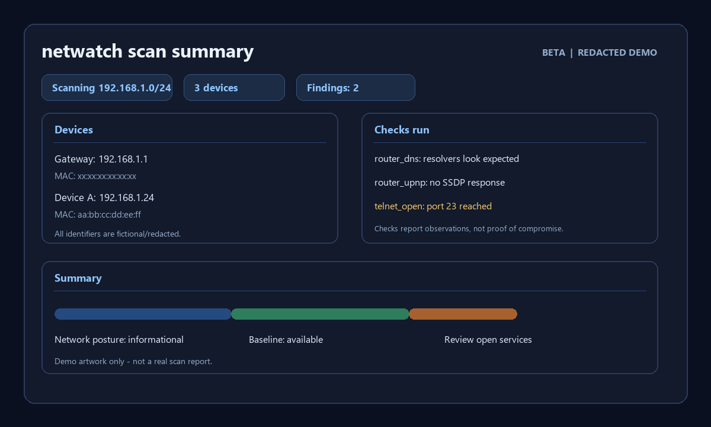

# netwatch

> A home network security scanner and change monitor. It finds devices that answer ARP or the selected TCP ports, remembers which ones you trust, checks for common weaknesses, and explains each problem in plain language with steps to consider.

**Status:** **Beta / pre-production.** The project is usable for cautious testing on networks you own, but it is not a production-ready security product. See the [Roadmap](#roadmap) for implemented and planned work; a checked item means the feature is implemented and covered by tests.

**License:** MIT — forkable, modifiable, and usable for private, academic, or commercial work, as long as the copyright and license notice remain in the source distribution.

**Development note:** This project was mostly built with AI assistance (often called “vibe coding”). Changes are tested, but AI-assisted development does not replace careful human review or real-world validation. Treat results as informational and verify important findings independently.

[](screenshots/netwatch-redacted-demo.png)

> **Open source and fork-friendly.** This repo is meant to be reusable and easy to remix; the MIT license allows others to fork and adapt the project without locking it down.

---

## Table of contents

1. [Why this exists](#why-this-exists)
2. [Features](#features)
3. [How it works](#how-it-works)
4. [Installation](#installation)
5. [Quick start](#quick-start)
6. [Commands](#commands)
7. [What it checks](#what-it-checks)
8. [Understanding the report](#understanding-the-report)
9. [Configuration](#configuration)
10. [Project structure](#project-structure)
11. [Writing your own check](#writing-your-own-check)
12. [Data and privacy](#data-and-privacy)
13. [Legal and ethical use](#legal-and-ethical-use)
14. [Known limitations](#known-limitations)
15. [Development](#development)
16. [Roadmap](#roadmap)
17. [Contributing](#contributing)
18. [License](#license)

---

## Why this exists

Most home networks are set up once and never looked at again. Compromises are rarely cinematic. They usually come from default or weak router passwords, an exposed admin panel, WPS left on, outdated firmware, hijacked DNS settings, or a forgotten device with an open service.

This project started after a real incident: a home network was accessed while nobody was there to notice. The question that followed was simple: *how would I even know?*

Existing tools are powerful but aimed at professionals (Nmap, OpenVAS, Nessus) or are closed consumer apps (Fing). `netwatch` aims at the gap between them:

- **Baseline and diff.** It remembers what your network normally looks like and tells you what changed.
- **Plain language.** Every finding explains what it means and how to fix it, written for people who are not security professionals.
- **Hackable.** Checks are small plugins, so anyone can add one.
- **Local only.** No cloud, no account, no telemetry.

## Features

- **Device discovery.** Finds devices that answer ARP or the selected TCP ports; uses best-effort MAC vendor lookup and hostname resolution.
- **Trusted-device baseline.** Mark current devices as known; get alerted on anything new.
- **Port and service scan.** Fast async scan of common ports with banner grabbing.
- **Read-only checks.** Plugin-based reachability checks for services, UPnP/SSDP discovery, system-configured DNS resolver checks, and gateway fingerprinting.
- **Experimental credential check.** A limited HTTP Basic Auth factory-default check for the gateway is available only with `--check-creds`; it is intentionally marked experimental and should not be treated as a headline feature. Do not run it against a real router unless you explicitly accept the lockout risk.
- **Reports.** Colored terminal output, JSON for automation, and a standalone HTML report with a security score.
- **Scan history.** Every scan is stored locally so you can compare over time.
- **Safety rails.** Refuses public IP ranges by default and, except for loopback tests, requires a local IPv4 address inside the target subnet before scanning.

## How it works

```
        ┌──────────────┐
        │  Discovery   │  ARP or selected TCP ports → responding devices
        └──────┬───────┘
               ▼
        ┌──────────────┐
        │ Port scanner │  async TCP connect scan + banner grab
        └──────┬───────┘
               ▼
        ┌──────────────┐
        │   Context    │  hosts, open ports, gateway, DNS, baseline
        └──────┬───────┘
               ▼
        ┌──────────────┐
        │    Checks    │  each plugin returns a list of Findings
        └──────┬───────┘
               ▼
        ┌──────────────┐        ┌──────────────┐
        │   Storage    │◄──────►│   Reporter   │  terminal / JSON / HTML
        │   (SQLite)   │        └──────────────┘
        └──────────────┘
```

Key design decisions:

- **Devices are identified by MAC address, not IP.** DHCP changes IPs, so MAC is the stable identity.
- **Scanning and reporting are separate.** The scanner produces data; reporters only render it.
- **Every check returns structured `Finding` objects** with severity, a plain-language explanation, and fix steps.

## Installation

### Requirements

- Python 3.11 or newer
- Linux, macOS, or Windows; TCP scanning works without raw-socket privileges
- ARP discovery may require root/administrator privileges and Npcap on Windows; if unavailable, netwatch warns and falls back to TCP discovery

### From source

```bash
git clone https://github.com/TheElbrus/NetWatch.git
cd NetWatch
python -m venv .venv
source .venv/bin/activate        # Windows: .venv\Scripts\activate
pip install -e .
netwatch                         # open the interactive menu
netwatch --help                  # show command help
```

> Running with `sudo` inside a virtualenv: use `sudo .venv/bin/netwatch ...` so the venv's Python is used.

### Planned

```bash
pipx install netwatch            # once published to PyPI
docker run --net=host --cap-add=NET_RAW netwatch scan
```

## Quick start

```bash
# 1. First scan: discover devices and run implemented checks
netwatch scan

# 2. Review the discovered devices before trusting the baseline
netwatch devices
netwatch baseline

# 3. Later, check what changed
netwatch diff

# 4. Review local scan history
netwatch history
```

Running `netwatch` with no arguments opens an interactive menu. Each scan asks you to confirm that you own or have permission to scan the target. Before saving a baseline, netwatch displays the devices it found and asks you to confirm that you recognize all of them. For command-line automation, `--yes` acknowledges scan permission and `--trust-all` explicitly trusts all devices found by a baseline scan.

### Current scan behavior

The scanner first tries an ARP sweep of the selected IPv4 CIDR, which can discover hosts even when they have no selected TCP ports open. It resolves hostnames and uses Scapy's bundled local manufacturer database for best-effort vendor names. If ARP is unavailable, it warns, sweeps the selected TCP ports, and merges in entries from the operating system's neighbor/ARP cache. That cache may be incomplete, so devices that do not answer ARP, are absent from the cache, or do not accept a selected port can be missed. Scans are limited to 4096 addresses and public ranges are refused unless `--allow-public` is explicitly supplied. `top1000` scans TCP ports 1 through 1000. Service banner collection is best-effort; the gateway fingerprint additionally makes a read-only HTTP request for the page title and `Server` header, and reads (but never writes to) a Telnet greeting when available.

The current service checks report reachable Telnet, FTP, SMB, RTSP, MQTT, plain HTTP, and Remote Desktop ports with plain-language context and suggestions. An open port means only that a TCP connection succeeded; the checks do not test service credentials, authentication policy, encryption settings, or exploitability. A scan with no findings means only that the implemented checks did not flag the observed data—it is not an all-clear or a complete security assessment. Before a baseline exists, devices are labeled `baseline not set`, not untrusted. Discovery method and check coverage/skips are shown in scan output and reports.

## Commands

| Command | Description |
|---------|-------------|
| `netwatch` | Open the interactive menu |
| `netwatch scan` | Discover hosts, scan selected TCP ports, and run implemented checks |
| `netwatch baseline` | Review found devices and confirm the trusted baseline |
| `netwatch diff` | Show new, missing, and changed devices versus the baseline |
| `netwatch devices` | List observed devices and whether they are trusted |
| `netwatch report` | Generate a standalone HTML report from the latest saved scan |
| `netwatch report --scan-id 3 --output report.html` | Render a selected scan to an HTML file |
| `netwatch report --json` | Print the saved scan and report summary as JSON |
| `netwatch history` | List recent locally saved scans |
| `netwatch checks` | List available checks and what they do |

### Common options

```text
--cidr TEXT          Subnet to scan (default: 192.168.1.0/24)
--interface TEXT     Network interface to use
--ports TEXT         Port set: top100 (default), top1000, or a list like 22,80,443
--only TEXT          Run only these checks (comma-separated names)
--skip TEXT          Skip these checks
--timeout FLOAT      Per-connection timeout in seconds (default: 0.5)
--concurrency INT    Max simultaneous connections (default: 200)
--json               Machine-readable output
--no-color           Disable colors
--allow-public       Allow scanning public IP ranges (off by default, see Legal)
--yes                Acknowledge that you own or have permission to scan the target
--trust-all          Explicitly trust all devices found by a baseline scan
--check-creds        Explicitly opt in to the gateway default-login check
--expected-dns TEXT  Comma-separated expected resolver IPs for router_dns
-v / --verbose       Increase diagnostic verbosity
```

`--interface` selects the interface for ARP discovery and is used by a route safety check; it does not bind all TCP connections to that interface or guarantee which path the operating system will use. The tunnel/VPN guard is a safeguard based on the route table it can inspect, not a routing guarantee. Confirm the selected CIDR and active route yourself before scanning.

The default-login test is experimental. It tries a short list of factory defaults and can trigger a router's login lockout policy. It requires the explicit `--check-creds` command-line flag; selecting `router_default_creds` with `--only` or setting it in a config file does not enable it. It is limited to a private or loopback gateway and supported HTTP Basic Auth challenges, and never attempts credentials over unencrypted LAN HTTP. Do not run this check against a real router unless you accept the lockout risk. It is not a headline feature and should be treated as a narrow opt-in check for controlled lab or home testing.

For report options, `netwatch report --help` lists `--scan-id`, `--output`, and `--json`. Reports are generated locally from saved scan data.

### Exit codes

Useful for scripting and cron jobs.

| Code | Meaning |
|------|---------|
| 0 | Scan finished, no findings at or above the fail threshold |
| 1 | Findings at or above the fail threshold (default: HIGH) |
| 2 | Unknown devices detected versus baseline |
| 3 | Usage or permission error |

`[report].fail_on` in the config file accepts `INFO`, `LOW`, `MEDIUM`, `HIGH`, or `CRITICAL` and controls the severity threshold for `scan` and `diff`. A new device detected against a saved baseline returns 2 regardless of this threshold. Invalid values return 3.

## What it checks

Severity levels: `INFO`, `LOW`, `MEDIUM`, `HIGH`, `CRITICAL`.

### Devices

| Check | Looks for | Typical severity |
|-------|-----------|------------------|
| `new_device` | A responding device not present in a saved trusted baseline | HIGH |
| `ip_conflict` | One IP claimed by multiple MACs or suspicious MAC/IP changes (planned; not implemented) | HIGH |
| `unknown_vendor` | Devices with randomized or unrecognized MAC vendors (planned; vendor names are looked up, but this check is not implemented) | INFO |

### Services

| Check | Looks for | Typical severity |
|-------|-----------|------------------|
| `telnet_open` | TCP port 23 reachable; credentials and service configuration are not tested | HIGH |
| `ftp_open` | TCP port 21 reachable; anonymous login is not tested | MEDIUM |
| `smb_exposed` | TCP port 445 reachable; SMB policy is not tested | LOW on private LAN addresses; MEDIUM otherwise |
| `rtsp_open` | TCP port 554 reachable; camera authentication is not tested | MEDIUM |
| `mqtt_open` | TCP port 1883 reachable; broker authentication is not tested | MEDIUM |
| `plain_http` / `plain_http_alt` | An HTTP response was observed on TCP port 80 or 8080 without TLS; admin-page identity is not verified | LOW |
| `rdp_open` | Remote Desktop (3389) open on the LAN | MEDIUM |

### Router / gateway

| Check | Looks for | Typical severity |
|-------|-----------|------------------|
| `router_default_creds` | Experimental: a small list of well-known default logins tested against a private/loopback gateway only after explicit `--check-creds` and a Basic Auth challenge; credentials are not sent over plain HTTP | CRITICAL |
| `router_upnp` | UPnP/SSDP discovery responding on a device; the SSDP-provided URL is not fetched | MEDIUM on gateway, LOW on other devices |
| `router_dns` | Checks this machine's configured DNS resolvers against optional `--expected-dns` values and flags an unrecognized public resolver; it does not inspect the router's DHCP leases or prove where a resolver was configured | HIGH / MEDIUM |
| Router fingerprint | Read-only gateway HTTP title, `Server` header, and Telnet greeting where available; brand matches only tailor the fix text | Informational context |
| `router_remote_admin` | Planned; not implemented | — |
| `router_firmware` | Planned; not implemented | — |

### Wi-Fi (planned)

| Check | Looks for | Typical severity |
|-------|-----------|------------------|
| `wifi_encryption` | Open, WEP, or WPA1 networks | CRITICAL / HIGH |
| `wifi_wps` | WPS enabled | MEDIUM |
| `wifi_ssid` | Default or identifying SSID patterns | LOW |

The `netwatch checks` command lists the checks that are registered in the current build. The tables above label planned checks explicitly; do not infer a check is implemented merely because it appears in this documentation.

## Understanding the report

Each finding looks like this:

```text
[HIGH] Telnet is open                                    192.168.1.23 (IP Camera)
  What this means:
    Telnet sends passwords in plain text and is a common entry point for botnets.
  How to fix:
    Disable Telnet in the device settings. If you need remote access, use SSH.
```

Generate an HTML report from the latest saved scan with `netwatch report`; choose a scan with `--scan-id` and a destination with `--output`. Reports include:

- An overall **security score** (0 to 100) and a per-severity summary
- A device table with trusted/unknown status
- A **diff section** comparing against the currently saved baseline, when one exists
- Findings grouped by severity with fix steps, ordered from highest severity

### Scoring

The score starts at 100 and subtracts 25 for each CRITICAL, 15 for HIGH, 8 for MEDIUM, and 3 for LOW finding (INFO has no penalty; the score is clamped to zero). It is a rough indicator, not a certification. A score of 100 does not mean your network is secure; it means none of these implemented checks fired.

## Configuration

Config file location: `~/.config/netwatch/config.toml` (Linux/macOS).

```toml
[scan]
ports = "top100"
timeout = 0.5
concurrency = 200

[network]
# Expected resolver IPs for this machine's router_dns check (not a DHCP lease inspection).
expected_dns = ["192.168.1.1", "1.1.1.1", "9.9.9.9"]

[checks]
skip = ["plain_http"]

[report]
fail_on = "HIGH"

[ignore]
# Silence a known, accepted finding
findings = [
  { check = "plain_http", target = "192.168.1.50" },
]
```

Configuration-file support reads `scan`, `network`, `checks`, `report`, and `ignore` blocks from `~/.netwatch/config.toml` or `~/.config/netwatch/config.toml`. CLI options override config values where the corresponding CLI option exists; `report.fail_on` currently has no CLI override. Its default is `HIGH`. The SQLite database is stored at `~/.netwatch/netwatch.db` by default; set `NETWATCH_DB_PATH` to use a different location.

## Project structure

```
netwatch/
├── pyproject.toml
├── README.md
├── netwatch/
│   ├── __init__.py
│   ├── __main__.py         # python -m netwatch entry point
│   ├── cli.py              # argparse commands and interactive menu
│   ├── checks.py           # check protocol, registry, and implemented checks
│   ├── config.py           # configuration defaults
│   ├── models.py           # Device, Finding, ScanResult, Severity
│   ├── scanner.py          # ARP discovery, async TCP scanner, banners
│   └── storage.py          # SQLite device baseline and scan history
└── tests/
    └── test_basic.py
```

## Writing your own check

A check implements `name`, `description`, and `run(device)`. Register it in `CHECKS` in `netwatch/checks.py`.

```python
# netwatch/checks.py
from netwatch.models import Device, Finding, Severity


class ExampleCheck:
    name = "example_http"
    description = "Reports a reachable cleartext HTTP response."

    def run(self, device: Device) -> list[Finding]:
        if 80 not in device.open_ports:
            return []
        return [Finding(
            name=self.name,
            title=f"HTTP is reachable on {device.ip}",
            description="A TCP connection to the HTTP port succeeded.",
            severity=Severity.LOW,
            recommendation="Use HTTPS before sending sensitive information.",
            evidence=["TCP port 80 accepted a connection"],
        )]
```

Guidelines for new checks:

1. **Read-only and non-destructive.** A check may connect and read. It must not change state on a device.
2. **Respect timeouts and rate limits.** Never hang or flood a weak router.
3. **Write the explanation for a non-expert.** No jargon without a one-line definition.
4. **Give actionable fix steps.** Prefer exact menu paths over "update your settings".
5. **No exploits and no brute forcing.** Default-credential checks use a small, documented list against the user's own gateway only.
6. **Add tests** using fake hosts (no real network needed).

## Data and privacy

- Everything stays on your machine. There is no telemetry, no account, and no network calls other than to devices on the scanned subnet.
- The database stores device MAC addresses, IPs, hostnames, open ports, and findings. Treat it as sensitive: it is a map of your network.
- Default-credential test results never store the credentials that worked, only the fact that a default login succeeded.
- Delete the local database with `rm -r ~/.netwatch` (PowerShell: `Remove-Item "$HOME\.netwatch" -Recurse`).

## Legal and ethical use

**Only scan networks you own or have explicit written permission to test.**

Scanning networks without permission can be illegal in many jurisdictions and can disrupt devices. This tool is built for defending your own home or lab network.

Built-in safeguards:

- Public IP ranges are refused unless `--allow-public` is passed.
- A scope notice must be confirmed on first run.
- Credential checks target only the detected gateway, with a short built-in list.
- There are no exploitation modules, and none will be accepted into the project.

The authors are not responsible for misuse.

## Known limitations

Being upfront about what this tool cannot do:

- **Windows without Npcap:** Scapy ARP discovery may not run. Netwatch then uses the selected TCP ports and the operating system's ARP/neighbor cache; devices missing from that cache that do not answer a selected port can be missed. Installing a compatible Npcap setup may enable ARP discovery, but does not make discovery complete.
- **Routing and interface selection are best-effort safeguards.** `--interface` is used for ARP discovery and route validation; TCP uses the operating system's routing table. The tunnel guard cannot guarantee the actual path of every connection.
- **DNS is a resolver-configuration check.** It reads the scanning machine's configured resolvers and compares them with optional expected values; it does not inspect router DHCP settings or determine the origin of a resolver.
- **It cannot fix your router automatically.** Routers have no common API. The tool detects, explains, and gives fix steps. Vendor-specific automation may come later.
- **It is not a full vulnerability scanner.** It does not do CVE matching across all software. Use OpenVAS or Nessus for that.
- **A clean report is not proof of safety.** It only covers implemented checks.
- **Devices may be missed.** Sleeping or firewalled devices, devices absent from the ARP cache, and devices that do not answer the selected TCP ports may not appear.
- **Guest networks and VLANs** are not visible from a different segment.
- **Wi-Fi-layer attacks** (evil twin, deauth, handshake capture) are out of scope for the CLI version.
- **Randomized MAC addresses** on phones can make devices look "new" each time. Use labels and a per-device trust option.

## Development

```bash
git clone https://github.com/TheElbrus/NetWatch.git
cd NetWatch
python -m venv .venv && source .venv/bin/activate
pip install -e ".[dev]"

pytest                     # run tests
ruff check .               # lint
ruff format .              # format
mypy netwatch              # type check
```

### Testing safely

Do not test against networks you do not own. Recommended lab:

1. A VM network set to **host-only** (isolated from the internet).
2. A deliberately vulnerable target such as Metasploitable on that network.
3. Your own home LAN for real-world runs.

Unit tests use fake `Device` objects and mocked sockets/subprocesses so they run without scanning a real network or requiring privileges.

### Dependencies

| Package | Purpose |
|---------|---------|
| `psutil` | Identify this machine's IPv4 addresses |
| `scapy` | ARP discovery and bundled offline MAC manufacturer lookup |
| `rich` | Formatted terminal summaries |
| `pytest` | Test suite (development only) |

## Roadmap

The `v0.1`–`v0.5` headings below are development milestones, not published release versions. The installable package version remains `0.1.0`; the project is still beta. Checked boxes are implemented and tested. Unchecked boxes are planned or not yet covered by tests.

### v0.1: Discovery and baseline (MVP)
- [x] Project setup, packaging, `netwatch --help`
- [x] ARP discovery with IP, MAC, offline vendor lookup, and hostname; if ARP is unavailable, TCP discovery is supplemented with the operating system's neighbor cache
- [x] SQLite storage for scans and devices
- [x] `baseline` and `diff` commands
- [x] New-device detection against an explicitly confirmed trusted baseline

### v0.2: Ports and checks
- [x] Async TCP port scanner with best-effort banner grabbing
- [x] Check plugin framework with `--only`, `--skip`, and `netwatch checks`
- [x] Read-only service reachability checks for Telnet, FTP, SMB, RTSP, MQTT, plain HTTP, and Remote Desktop (credentials/configuration are not tested)

### v0.3: Router checks
- [x] Gateway detection from the operating system's default route (no guessed `.1` fallback)
- [x] UPnP/SSDP response detection without fetching device-provided URLs
- [x] DNS resolver heuristic using system-configured resolvers and optional expected resolver values (not DHCP inspection)
- [x] Opt-in default-credential check against the detected gateway; no credential attempts over unencrypted HTTP
- [x] Read-only gateway fingerprint (HTTP title, `Server` header, and Telnet greeting) with tested brand-specific Telnet guidance

### v0.4: Reports
- [x] Rich terminal scan summary
- [x] JSON output for scans
- [ ] JSON output for baselines, device lists, diffs, history, checks, and saved-scan reports (implemented, but not yet covered by the test suite)
- [x] Standalone HTML report with score, baseline diff, severity summary, and fix steps
- [x] Local scan history and baseline comparison (basic CLI output)

### v0.5: Polish and release
- [x] Config file and ignore rules
- [x] Test suite and CI (GitHub Actions)
- [x] Redacted demo screenshot in this README
- [ ] Docker image
- [ ] PyPI release

### Later
- [ ] Wi-Fi layer checks (encryption, WPS)
- [ ] ARP spoofing detection over time
- [ ] Scheduled/always-on mode with Telegram or email alerts (Raspberry Pi)
- [ ] Router-specific fix automation for selected brands
- [x] Tested Windows TCP sweep and operating-system neighbor-cache fallback; ARP discovery may require compatible Npcap setup
- [ ] External exposure check for your public IP

## Contributing

Contributions are welcome, especially new checks and fix guides for specific router brands.

1. Open an issue describing the check or change.
2. Fork the repo and create a branch.
3. Add tests and make sure `pytest` and `ruff check .` pass.
4. Open a pull request.

Ground rules: non-destructive checks only, plain-language explanations, no exploit code.

## License

This project is licensed under the MIT License. See [LICENSE](LICENSE) for the full text.

The MIT license is intentionally permissive: you may fork the project, modify it, run it privately, distribute it, or use it in commercial work. The only requirement is that the original copyright and permission notice remain in the source distribution.
